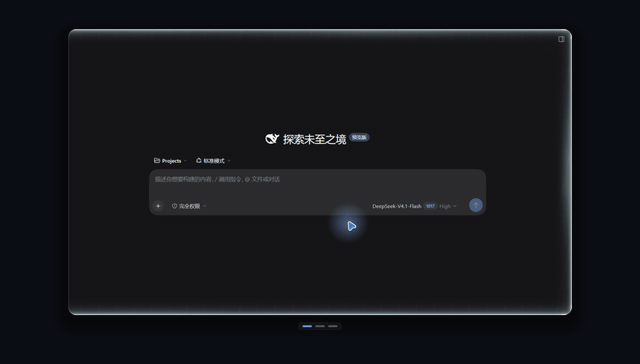
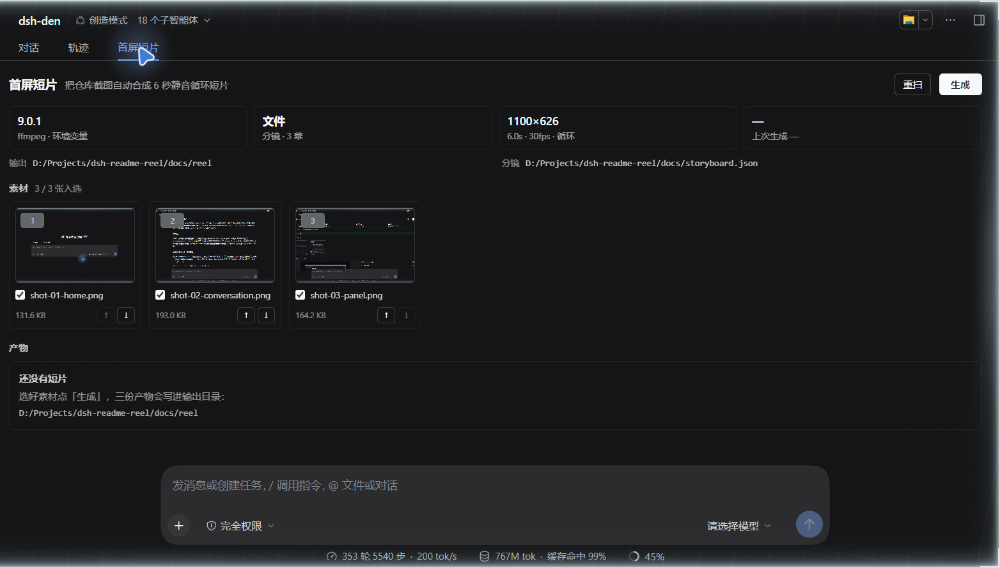
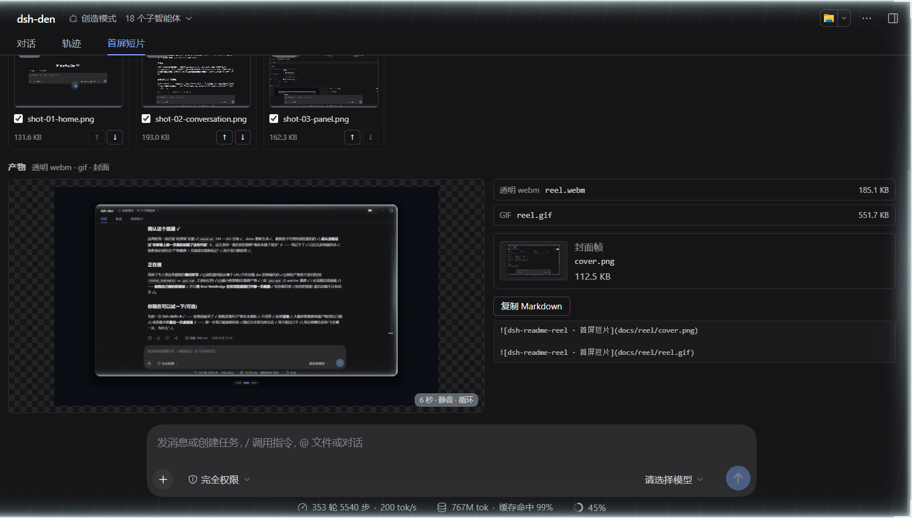

# dsh-readme-reel

把插件仓库里的截图排成一条 **6 秒无声循环短片**：透明背景 webm + 通用 gif + 封面帧，直接放进 README 首屏或插件市场条目。



上面这条片子由仓库里的三张真实截图（`docs/shots/`）生成，重跑一条命令就能复现：

```sh
node bin/reel.mjs docs/storyboard.json
```

## 为什么要有它

插件市场里绝大多数条目只有一张静态截图。一张图说不清「从哪进来、点哪个页签、得到什么」，而录屏要人举着鼠标、剪掉首尾、压到几百 KB，还得让它首尾接得上——对仓库里**已经存在的截图**来说，这些全是可自动化的机械活。

这个插件把这件机械活收成一条管线：截图是唯一素材，排版、交叉淡入、进度条指示、精确到毫秒的时间轴由它算，编码交给 ffmpeg。它**不叠字、不配音、不依赖字体**——截图本身是唯一的信息源，你不需要为短片再写一遍文案。

## 长什么样

面板在对话视图里，叫「首屏短片」：



选好素材点「生成」，三件产物会在面板里直接可看，下面还有一段可直接粘进 README 的 Markdown：



产物清单：

| 文件 | 说明 |
|---|---|
| `reel.webm` | 1100×626、6.000s、30fps、VP9 **保留 alpha**（`yuva420p`）、无音轨、循环播放 |
| `reel.gif` | 同一时间轴，alpha 压平到深色垫底、640 宽、20fps、无限循环 |
| `cover.png` | 停留最长那一幕的首帧（原始像素，不重编码），给不支持动图的地方 |
| `reel.json` | 清单：每幕停留、时间轴、三个产物的尺寸与 sha256、ffmpeg 版本、耗时 |

`docs/reel/reel.json` 就是这次交付的实际清单——包括三个文件的 sha256，方便核对产物有没有被改过。

## 六秒是算出来的，不是凑出来的

「6 秒循环」听起来像文案，实际是一组硬约束：

- **时长精确**：每幕停留是整数毫秒，`Σ停留 + 转场数 × 转场时长 === durationMs`，由水位分配（`distributeHolds`）保证。写 6000 就得到 6000，不会出现 5.94s 的「约等于」。
- **首尾同帧**：`loop: true` 时，最后一幕用一整段转场回到**第一幕**，这段转场在 `durationMs` 处正好结束。t=0 与 t=duration 是同一帧，`<video loop>` 和 GIF 的重播点看不出来。
- **不靠「差不多」**：`test/storyboard.test.mjs` 直接钉住「每幕至少一帧、停留之和精确、转场区间不重叠、边界钳制」；`test/encode.test.mjs` 用真实 ffmpeg 探测 webm 的 `yuva420p` 与 6.00s 时长、gif 的帧数与总时长。

没有 ffmpeg 的机器上，编码相关的 16 个用例会 **skip** 而不是失败——`node --test` 在两种环境下都是绿的。

## 安装

装到 DSH 的某个 profile（插件市场条目的安装方式）：

```sh
dsh plugin --profile <你的 profile> add github:dingchenhui0618-arch/dsh-readme-reel
```

也可以从本地路径装（改代码时用这个）：

```sh
dsh plugin --profile <你的 profile> add D:\Projects\dsh-readme-reel
```

装好后重启 DSH，对话视图里多一个「首屏短片」Tab。桌面端在应用里装插件，profile 由应用自己管理，不用手敲上面的命令。

插件挂在 DSH 的 `webServer` 服务上，所以 profile 里要有 Web GUI（`dsh-web-app` 那一套）：桌面端和常规 Web profile 自带；纯 CLI 手建的空 profile 里它会停在 `pending (waiting for service: webServer)`，那是 DSH 的依赖语义，不是装失败了。

**还没发布到 npm**，所以上面只有 GitHub 与本地路径两种装法；仓库里的 `lib/` 是入库的构建产物，装的时候不编译、不跑构建脚本。

只想用命令行（不进 DSH）也可以：

```sh
git clone https://github.com/dingchenhui0618-arch/dsh-readme-reel D:\Projects\dsh-readme-reel
node D:\Projects\dsh-readme-reel\bin\reel.mjs --project <你的仓库>
```

## 用法

### 面板

1. 在 DSH 里打开你要做短片的那个仓库的会话（插件默认在会话工作目录里找 `docs/shots/*.png`）。
2. 切到「首屏短片」页签：它会显示 ffmpeg 是否可用、分镜来自文件还是自动、画幅/时长/fps，以及扫描到的截图。
3. 勾选素材、用 ↑/↓ 调顺序（顺序就是播放顺序），点「生成」。产物写入 `<项目>/docs/reel/`。
4. 点「复制 Markdown」拿到直接可粘的 `` + ``。

### 命令行

```sh
# 1) 自动模式：把 docs/shots/ 里的 PNG 按文件名排序，平均分配到 6 秒
node bin/reel.mjs --project .

# 2) 分镜模式：完全由 storyboard.json 决定（推荐，可进版本库）
node bin/reel.mjs docs/storyboard.json

# 3) 只挑几张、临时出一版预览
node bin/reel.mjs --sources docs/shots/a.png,docs/shots/b.png --duration 2000 --width 960 --height 600
```

常用参数（完整列表见 `node bin/reel.mjs --help`）：

| 参数 | 默认 | 作用 |
|---|---|---|
| `--project <dir>` | 自动向上发现 | 项目根；默认从它找 `docs/shots`、`docs/reel`、`docs/storyboard.json` |
| `--out <dir>` | `<project>/docs/reel` | 产物目录 |
| `--shots <dir>` | `<project>/docs/shots` | 自动模式的素材目录 |
| `--sources a,b,c` | — | 覆盖 storyboard，按给定顺序只用这几张 |
| `--duration / --fps / --width / --height` | 6000 / 30 / 960 / 600 | 时间轴与画布 |
| `--gif-width / --gif-fps / --matte` | 640 / 20 / `#0b0e14` | gif 的宽度、帧率、垫底色 |
| `--crf <n>` | 34 | VP9 质量（越大越小越糊） |
| `--ffmpeg <path>` | 环境变量或 PATH | 指定 ffmpeg |
| `--keep-frames` | 关 | 保留中间 PNG 帧，排错用 |
| `--json` | 关 | 只输出 manifest JSON，方便 CI |
| `--ffmpeg-check` | — | 只探测 ffmpeg 并打印路径/版本/来源 |

退出码：`0` 成功，`1` 生成失败，`2` 参数错误。

### storyboard.json

```json
{
  "version": 1,
  "title": "dsh-readme-reel · 首屏短片",
  "durationMs": 6000,
  "fps": 30,
  "size": { "width": 1100, "height": 626 },
  "loop": true,
  "layout": "plain",
  "transition": "fade",
  "transitionMs": 360,
  "scenes": [
    { "src": "docs/shots/shot-01-home.png", "hold": 1500 },
    { "src": "docs/shots/shot-02-conversation.png", "hold": 1500 },
    { "src": "docs/shots/shot-03-panel.png", "hold": 2600 }
  ]
}
```

字段与限制：

| 字段 | 取值 | 说明 |
|---|---|---|
| `durationMs` | 1000–20000 | 总时长，默认 6000 |
| `fps` | 10–60 | 帧率，默认 30 |
| `size` | 320–1920 × 200–1200（自动取偶数） | 画布尺寸，默认 960×600 |
| `loop` | `true`/`false` | 是否把最后一幕转场回第一幕（默认开） |
| `layout` | `window` / `plain` | `window` 画一圈窗框，`plain` 只留圆角卡片；每幕可用 `scenes[].layout` 覆盖 |
| `transition` | `fade` / `slide-left` / `cut` | 转场方式，默认 `fade` |
| `transitionMs` | 80–1200 | 单段转场时长，且 `transitionMs × 幕数 < durationMs` |
| `scenes[].hold` | 100–20000 | **相对权重**不是绝对毫秒：省略时按 1000 均分，实际停留由水位分配算 |
| `scenes[].focus` | `{x,y,w,h}`，0–1 | 从大截图里框一块重点区域做卡片，其余裁掉 |
| `theme` | `accent/chrome/content/border/shadow` | `#rrggbb`；只在 `window` 布局里可见 |

大于 `durationMs - 转场` 的停留也会被自动压回来，所以先写个大概权重、再调 `durationMs` 是安全的。

## 它怎么工作

```
截图 PNG ──► storyboard 归一化 ──► 逐幕排版（圆角卡片 / SDF 圆角 / 柔和阴影 / 可选窗框）
                                        │
                                        ▼
                        时间轴采样 t=0..duration 每 1/fps 秒 → RGBA 帧（直通道 alpha）
                                        │
                                        ▼
              ffmpeg:  VP9  yuva420p  /  matte+gif palette  /  cover = 原始帧字节复制
                                        │
                                        ▼
                       reel.webm  reel.gif  cover.png  reel.json
```

- PNG 编解码是自己写的（`src/png.js`，只依赖 `node:zlib`）：五种行过滤、调色板 + tRNS、灰度都支持，不需要 `sharp`/`canvas`。
- 合成器（`src/raster.js` / `src/compose.js`）做直通道 RGBA 混色、SDF 圆角矩形、柔化阴影、盒式降采样、预乘 alpha 交叉淡入、圆角遮罩、进度条胶囊。
- 帧默认不落盘：写进临时目录、编码完即删（`--keep-frames` 才留下）。
- gif 把 alpha 压平到 `--matte`（默认 `#0b0e14`）再走一套 `palettegen/paletteuse`，避免 GIF 的 1-bit 透明度啃掉抗锯齿边缘；垫底色和画布边缘同色，所以看起来是「透明」的。
- ffmpeg 走 `DSH_README_REEL_FFMPEG` → PATH 的顺序发现，**不打包二进制**；找不到时明确报错并告诉你怎么装，不假装成功。

## 边界（它不做什么）

- **不渲染文字**。没有字体依赖，也就没有标题/字幕；信息只能来自截图本身。这是刻意的取舍，不是没做完。
- **只吃 PNG**。不吃视频、不吃 JPEG、不录屏——素材必须已经是静态截图。
- **gif 只有 8-bit 调色板**。深色渐变可能有轻微 banding（已用 bayer 抖动）；要真 alpha 用 webm。
- **没有时间轴编辑器**。改顺序、改停留靠面板的 ↑/↓ 与 `storyboard.json`，没有拖拽轨道。
- **不是截图工具**。截图怎么来是使用者的事；面板只负责把已有截图变成短片。
- 面板只在 DSH Web 端实测截图（`docs/*.png` 都是真实 Web UI 渲染）。桌面端用的是同一套 client，但没有为本仓库截过图。

## 参考了谁，和它差在哪

工程骨架（零依赖构建、`cordis.patch.yml`、host/client 两半、README/测试的目录结构、卸载即注销的纪律）**参考了同作者的 [dsh-warden](https://github.com/dingchenhui0618-arch/dsh-warden)**（MIT）。这是「按已验证的接入形状搭新房子」，不是 fork：

| | dsh-warden | dsh-readme-reel |
|---|---|---|
| 干的事 | 工具调用前的对抗式审查门 | 截图 → 6 秒循环短片 |
| 产物 | 判定流 + JSONL 审计 | webm / gif / cover + manifest |
| 核心代码 | 风险分类、审查模型调用、降级策略 | PNG 编解码、SDF 排版合成、水位分配时间轴、ffmpeg 编码 |
| 与 ffmpeg 的关系 | 无关 | 唯一外部依赖，运行时发现，找不到就 fail-fast |

没有复制 warden 的业务逻辑；共享的只有 harness 的接入形状（`apply(ctx)`、`inject: ['webServer']`、`ctx.effect` 注销、client 的 `__ModuleLoader__` 包装）与工程约定（零运行时依赖、测试先行、构建产物入库）。

## 开发

```sh
node scripts/build.mjs    # 零依赖构建：复制 src/*.js、包装 client、产出 lib/
node --test               # 110 个测试
node scripts/audit.mjs    # 推送前三查：密钥 / .gitignore / 无关文件
```

测试分布：PNG 编解码 7、storyboard 时间轴 10、栅格合成 12、画面合成 9、编码 14、client 面板 20、reel 管线 10、host 12、CLI 9、审计脚本 7。

- 有 ffmpeg：`110 pass`（编码用例用真实 ffmpeg 探测 `yuva420p`、时长、帧数、gif 全不透明）。
- 没有 ffmpeg：`94 pass / 16 skip`，仍然 `0 fail`。

`lib/` 是构建产物，改 `src/` 之后必须重新 build 再提交。

## 仓库里的东西

```
docs/shots/      三张真实 DSH Web UI 截图（裁到内容区，尺寸一致）
docs/reel/       用它们生成的 webm / gif / cover / manifest
docs/panel*.png  面板的真实渲染截图
docs/storyboard.json  这份 README 短片的分镜
docs/CONTRACT.md 管线、编码器、HTTP、client 之间的内部契约
src/             管线（reel/compose/storyboard/raster/png/encode/host/client/cli）
test/            node --test，全部零依赖
scripts/         build.mjs（构建）、audit.mjs（推送前三查）
```

## License

MIT
